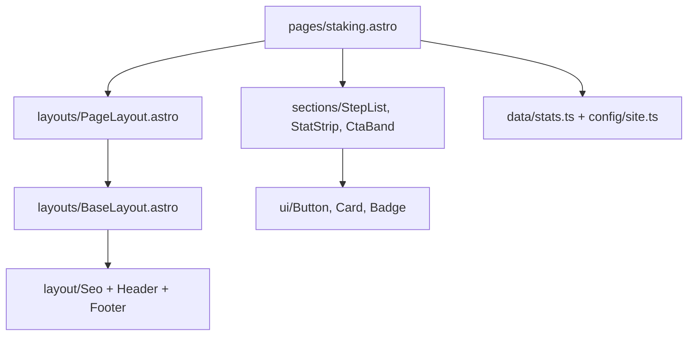

# Architecture

## Stack

| Piece        | What                                                    | Why                                                                                                   |
| ------------ | ------------------------------------------------------- | ----------------------------------------------------------------------------------------------------- |
| Framework    | **Astro 7**, `output: "static"`                         | Every page is pre-rendered HTML. Fast, cheap, nothing to run. See [[ADR-001 Astro and static output]] |
| Hosting      | **Vercel** via `@astrojs/vercel`                        | Git push deploys, preview URL per branch. See [[Vercel]]                                              |
| Styling      | **Tailwind v4** + CSS tokens in `src/styles/tokens.css` | See [[ADR-002 Tailwind v4 with CSS tokens]] and [[Design System]]                                     |
| Content      | Markdown/MDX and YAML in **content collections**        | See [[ADR-003 Content in the repo]]                                                                   |
| Icons        | `astro-icon` + **Phosphor** set (`ph:*`)                | Inlined SVG at build time, zero JS                                                                    |
| Fonts        | **Geist** + **Geist Mono**, self-hosted via Fontsource  | No Google Fonts request, no layout shift                                                              |
| Integrations | `@astrojs/mdx`, `@astrojs/sitemap`, `@astrojs/rss`      | Blog, sitemap, RSS feed                                                                               |

There is **no client-side framework**. JavaScript is limited to small inline `<script>` blocks inside the components that need them:

| Component                      | What the script does                                                                                     |
| ------------------------------ | -------------------------------------------------------------------------------------------------------- |
| `layout/Header.astro`          | Dropdowns (hover/click, sliding between menus, shared backdrop), transparent bar at the top, mobile menu |
| `layouts/BaseLayout.astro`     | Reveals `[data-reveal]` elements on scroll                                                               |
| `sections/ShaderField.astro`   | WebGL dot field reacting to the pointer                                                                  |
| `sections/Hero.astro`          | Orbiting app icons                                                                                       |
| `sections/TabShowcase.astro`   | Step switcher with auto-advance and pause                                                                |
| `sections/RoadmapTracks.astro` | Roadmap popups (`<dialog>`) and deep links                                                               |
| `pages/ecosystem.astro`        | Category filter                                                                                          |
| `pages/brand.astro`            | Copy a colour's hex code                                                                                 |

## Folder structure

```
astro.config.mjs        site URL, adapter, integrations, all redirects
vercel.json             security and cache headers
scripts/                generate-brand-assets.mjs (favicon, OG image), generate-logo-pngs.mjs,
                        sync-ecosystem.mjs (dApp registry → icons + JSON)
public/                 served as-is: favicon, OG image, brand/ (logo downloads),
                        logos/ (wallets, exchanges), partners/, ecosystem/ (app icons)
src/
  config/site.ts        name, navigation, footer, socials, shared external links
  data/*.ts             typed content shown on pages (wallets, stats, about, secret2…)
  content.config.ts     schemas for the blog and roadmap collections
  content/blog/         blog posts (.md / .mdx)
  content/roadmap.yaml  every Secret 2.0 roadmap component, one file
  lib/content.ts        helpers: getPosts, getRoadmap, formatDate, readingTime…
  assets/screens/       real product screenshots (optimised by astro:assets)
  styles/tokens.css     design tokens (the only place colours are defined)
  styles/global.css     base styles, type scale, utilities, blog prose styles
  layouts/              BaseLayout, PageLayout, PostLayout
  components/ui/        primitives: Button, Card, Badge, Section…
  components/layout/    Header, Footer, Seo
  components/sections/  page sections: Hero, TabShowcase, StepList, CtaBand…
  pages/                one file = one URL
docs/                   this vault
```

## The three rules

1. **Pages compose sections and primitives.** A page reads like a table of contents: a layout, then `Section` blocks built from section components and UI primitives. A block used on one page may be written inline in that page with primitives (`Section`, `SectionHeading`, `Card`, `Button`…). As soon as a block is needed on a second page, it becomes a section component. Section components use primitives, never page-specific data imports.
2. **Content lives in data, not in components.** Links, wallets, exchanges, figures, nav items and page copy that may change come from `src/config/` and `src/data/` (or `src/content/`). Components receive them as props. Changing an exchange never means touching markup.
3. **Colours and fonts come from tokens only.** Use `bg-accent`, `text-muted`, `border-line`… never a raw hex in a component. See [[Design System]].

## How a page renders



- `BaseLayout` outputs `<html>`, `<head>` (via `Seo`), header, footer and the reveal script.
- `PageLayout` adds the standard inner-page header panel and the content sheet.
- `PostLayout` is the blog post template in the same style.

See [[Layouts]] for details and [[Pages]] for what every page is built from.

## Routes

| URL                                                                                                                                   | File                                                           |
| ------------------------------------------------------------------------------------------------------------------------------------- | -------------------------------------------------------------- |
| `/`                                                                                                                                   | `pages/index.astro`                                            |
| `/scrt`, `/wallets`, `/staking`, `/builders`, `/secret-2`, `/grants`, `/ecosystem`, `/roadmap`, `/foundation`, `/community`, `/brand` | `pages/<name>.astro`                                           |
| `/blog`                                                                                                                               | `pages/blog/index.astro`                                       |
| `/blog/<post-id>`                                                                                                                     | `pages/blog/[...slug].astro` (one per file in `content/blog/`) |
| `/blog/tags/<tag>`                                                                                                                    | `pages/blog/tags/[tag].astro`                                  |
| `/rss.xml`, `/robots.txt`                                                                                                             | `pages/rss.xml.ts`, `pages/robots.txt.ts`                      |
| `/sitemap-index.xml`                                                                                                                  | generated by `@astrojs/sitemap`                                |
| old scrt.network URLs                                                                                                                 | `redirects` in `astro.config.mjs` (301)                        |
| anything else                                                                                                                         | `pages/404.astro`                                              |

## Motion

- Page titles use the `animate-rise` utility (CSS keyframes, defined in tokens).
- Any element with `data-reveal` fades up once when it scrolls into view. Stagger it with `style="--reveal-i:2"`.
- The partner strip uses `animate-marquee`. **One marquee per page.**
- Anything that runs continuously (shader, orbit, step switcher) pauses when off screen.
- `prefers-reduced-motion` disables all of it (see `global.css` and each script).
- Never use `window.addEventListener("scroll")`. Use `IntersectionObserver`, like the reveal script and the header's top-of-page sentinel.

Related: [[Pages]], [[Section components]], [[Adding a page]].
