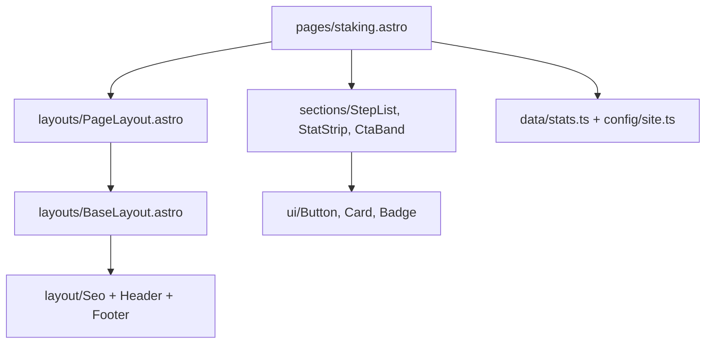

# Architecture

## Stack

| Piece        | What                                                    | Why                                                                                                   |
| ------------ | ------------------------------------------------------- | ----------------------------------------------------------------------------------------------------- |
| Framework    | **Astro 7**, `output: "static"`                         | Every page is pre-rendered HTML. Fast, cheap, nothing to run. See [[ADR-001 Astro and static output]] |
| Hosting      | **Vercel** via `@astrojs/vercel`                        | Git push deploys, preview URL per branch. See [[Vercel]]                                              |
| Styling      | **Tailwind v4** + CSS tokens in `src/styles/tokens.css` | See [[ADR-002 Tailwind v4 with CSS tokens]] and [[Design System]]                                     |
| Content      | Markdown/MDX in **content collections**                 | See [[ADR-003 Content in the repo]]                                                                   |
| Icons        | `astro-icon` + **Phosphor** set (`ph:*`)                | Inlined SVG at build time, zero JS                                                                    |
| Fonts        | **Geist** + **Geist Mono**, self-hosted via Fontsource  | No Google Fonts request, no layout shift                                                              |
| Integrations | `@astrojs/mdx`, `@astrojs/sitemap`, `@astrojs/rss`      | Blog, sitemap, RSS feed                                                                               |

There is **no client-side framework**. The only JavaScript is a few small inline scripts: the header mega menu (`Header.astro`), scroll reveal (`BaseLayout.astro`), the dot-wave background (`ShaderField.astro`), hero icon parallax (`Hero.astro`) and the category filter on `/ecosystem`.

## Folder structure

```
astro.config.mjs        site URL, adapter, integrations
vercel.json             redirects from old URLs, security + cache headers
scripts/                tools: generate-brand-assets.mjs, sync-ecosystem.mjs
public/                 served as-is: favicon, OG image, brand/, partners/
src/
  config/site.ts        name, nav, footer, socials, legacy links
  data/*.ts             typed data shown on pages (wallets, exchanges, stats…)
  content.config.ts     schemas for the blog and roadmap collections
  content/blog/         blog posts (.md / .mdx)
  content/roadmap/      roadmap items (.md)
  lib/content.ts        helpers: getPosts, getRoadmap, formatDate…
  styles/tokens.css     design tokens (the only place colours are defined)
  styles/global.css     base styles, utilities, blog prose styles
  layouts/              BaseLayout, PageLayout, PostLayout
  components/ui/        primitives: Button, Card, Badge, Section…
  components/layout/    Header, Footer, Seo
  components/sections/  page sections: Hero, StepList, FeatureGrid…
  pages/                one file = one URL
docs/                   this vault
```

## The three rules

1. **Pages compose sections. Sections compose UI primitives.** A page file should read like a table of contents. If you are writing lots of markup in a page, it probably wants to be a section component.
2. **Content lives in data, not in components.** Links, wallets, exchanges, figures and nav items come from `src/config/` and `src/data/`. Components receive them as props. Changing an exchange never means touching markup.
3. **Colours and fonts come from tokens only.** Use `bg-accent`, `text-muted`, `border-line`… never a raw hex in a component. See [[Design System]].

## How a page renders



- `BaseLayout` outputs `<html>`, `<head>` (via `Seo`), header, footer and the reveal script.
- `PageLayout` adds the standard inner-page header (title, intro, optional CTAs in the `actions` slot).
- `PostLayout` is the blog post template.

## Routes

| URL                                                                    | File                                                           |
| ---------------------------------------------------------------------- | -------------------------------------------------------------- |
| `/`                                                                    | `pages/index.astro`                                            |
| `/scrt`, `/wallets`, `/staking`, `/ecosystem`, `/builders`, `/roadmap` | `pages/<name>.astro`                                           |
| `/blog`                                                                | `pages/blog/index.astro`                                       |
| `/blog/<post-id>`                                                      | `pages/blog/[...slug].astro` (one per file in `content/blog/`) |
| `/blog/tags/<tag>`                                                     | `pages/blog/tags/[tag].astro`                                  |
| `/rss.xml`, `/robots.txt`                                              | `pages/rss.xml.ts`, `pages/robots.txt.ts`                      |
| `/sitemap-index.xml`                                                   | generated by `@astrojs/sitemap`                                |
| anything else                                                          | `pages/404.astro`                                              |

## Motion

- Hero and page headers use the `animate-rise` utility (CSS keyframes, defined in tokens).
- Any element with `data-reveal` fades up once when it scrolls into view. Stagger it with `style="--reveal-i:2"`.
- The partner logos use `animate-marquee`. **One marquee per page.**
- `prefers-reduced-motion` disables all of it (see `global.css`).
- Never use `window.addEventListener("scroll")`. Use `IntersectionObserver` like `Header.astro` does.

Related: [[Section components]], [[Adding a page]].
